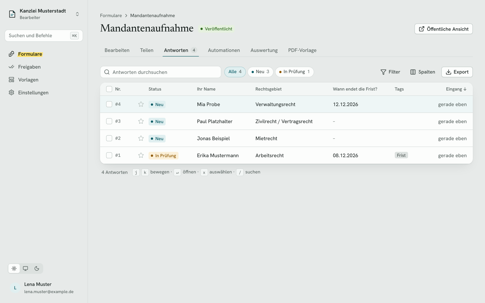
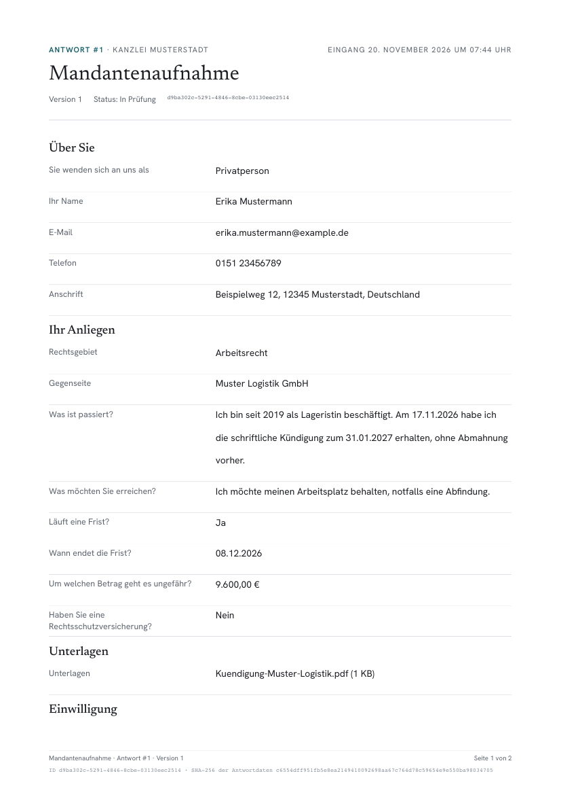

<p align="center">
  <picture>
    <source media="(prefers-color-scheme: dark)" srcset="docs/bilder/plica-logo-dunkel.svg">
    
  </picture>
</p>

<h1 align="center">PLICA</h1>

<p align="center">
  <strong>Online-Formulare für die Kanzlei – auf dem eigenen Server.</strong><br>
  Mandantenaufnahme, Unterlagen-Upload und Einwilligungen online entgegennehmen,<br>
  im Team prüfen und als PDF oder per Schnittstelle zur Akte geben.
</p>

<p align="center">
  <a href="#schnellstart"><strong>Schnellstart</strong></a> ·
  <a href="docs/handbuch/README.md"><strong>Handbuch</strong></a> ·
  <a href="docs/handbuch/00-erste-schritte.md">Erste Schritte</a> ·
  <a href="docs/handbuch/19-installation-mit-claude-code.md">Installation mit Claude Code</a> ·
  <a href="LICENSE">MIT-Lizenz</a>
</p>

<picture>
  <source media="(prefers-color-scheme: dark)" srcset="docs/bilder/antwort-bearbeitet-dunkel.png">
  
</picture>

<p align="center"><sub>Eine eingegangene Mandatsanfrage: Angaben der Mandantin, Status, Tag, interne Notiz und lückenloser Verlauf.</sub></p>

## Wofür PLICA da ist

Mandantinnen und Mandanten füllen ein Formular über einen Link aus – ohne Konto, auch am Smartphone, mit Dateien und Unterschrift. Die Antworten landen geordnet bei Ihrem Team: Die ReFa übernimmt die Anfrage, die Anwältin prüft, das PDF geht zur Akte. Formulare, Antworten und Dateien bleiben auf Ihrem Server; PLICA braucht keinen Cloud-Dienst und setzt kein Tracking ein.

| 1 · Mandantin füllt aus | 2 · Team bearbeitet | 3 · Ergebnis zur Akte |
|---|---|---|
|  |  |  |
| Mehrseitiges Formular mit Regeln: Bei laufender Frist fragt es das Fristende ab und kündigt einen Rückruf an. | Status, Tags, Notizen, Ansichten und Tastaturbedienung; Uploads mit Virenprüfung oder Quarantäne. | PDF nach eigener Vorlage, Export oder signierter Webhook an die Kanzleisoftware. |

## Wo geht es weiter?

| Sie sind … | Lesen Sie |
|---|---|
| **neu im Team, ReFa oder Sekretariat** | [Erste Schritte](docs/handbuch/00-erste-schritte.md) – Ihr erster Vorgang Schritt für Schritt mit Beispieldaten |
| **Rechtsanwältin oder Rechtsanwalt** | [Kanzleiabläufe](docs/handbuch/09-kanzleiablaeufe.md) – wer was tut, wie Sie ein Ergebnis prüfen und weiterverwenden |
| **Admin oder IT** | [Installation mit Claude Code](docs/handbuch/19-installation-mit-claude-code.md), [Installation](docs/handbuch/20-installation.md), [Konfiguration](docs/handbuch/21-konfiguration.md), [Sicherung](docs/handbuch/23-sicherung.md) |

## Funktionen im Überblick

- **Formulare bauen** im visuellen Editor: 30 Feldtypen von Name und Adresse bis Betrag, Datei-Upload und Unterschrift; bedingte Logik und Berechnungen ohne Programmierung – [Kapitel 2](docs/handbuch/02-formulare-erstellen.md), [3](docs/handbuch/03-logik.md)
- **Zehn Vorlagen**, darunter Mandantenaufnahme, Dokumentenupload und Schweigepflichtentbindung; Entwurf aus einer Beschreibung, optional mit eigener KI – [Kapitel 2](docs/handbuch/02-formulare-erstellen.md#aus-einer-vorlage), [9](docs/handbuch/09-kanzleiablaeufe.md#formular-aus-einer-beschreibung-erzeugen-mit-oder-ohne-ki)
- **Drei Darstellungen**: klassisch, eine Frage pro Karte oder Assistent mit Schritten; eigene Farbe, Schrift und Logo – [Kapitel 4](docs/handbuch/04-darstellung.md)
- **Veröffentlichen** per Link, QR-Code oder Einbettung in die Kanzlei-Website; Passwort, Zeitfenster, Antwortlimit, später fortsetzen, Folgeformulare – [Kapitel 5](docs/handbuch/05-veroeffentlichen-teilen.md)
- **Antworten bearbeiten** mit Status, Tags, Notizen, Verlauf, gespeicherten Ansichten und Auswertung – [Kapitel 6](docs/handbuch/06-antworten.md)
- **Export und PDF**: XLSX, CSV, JSON und PDF nach eigener Vorlage – [Kapitel 7](docs/handbuch/07-export-pdf.md)
- **Automationen und Freigaben**: Eingangsbestätigung, Team-Benachrichtigung, Vier-Augen-Freigabe, signierte Webhooks (Beispiel: j-lawyer) – [Kapitel 8](docs/handbuch/08-automationen.md), [Integrationen](docs/handbuch/integrationen.md)
- **REST-API** mit OpenAPI-Beschreibung – [Integrationen](docs/handbuch/integrationen.md#rest-api)
- **Team und Sicherheit**: Workspaces, fünf Rollen, Zwei-Faktor-Anmeldung, Anmeldung über OIDC (z. B. authentik), Protokoll, Abgleich mit OWASP ASVS 5.0 – [Kapitel 10](docs/handbuch/10-team-rollen.md), [ASVS](docs/sicherheit/asvs.md)
- **Datenschutz**: Aufbewahrungsfristen mit endgültiger Löschung, Uploads mit Inhaltsprüfung und ClamAV – [Kapitel 12](docs/handbuch/12-datenschutz-aufbewahrung.md), [Datenschutz](docs/datenschutz.md)

Jede Funktion mit Rolle, Fundstelle und Kapitel: [Funktionsliste](docs/handbuch/29-funktionsliste.md).

## Schnellstart

Voraussetzung: Docker mit Compose v2.24 oder neuer, `git`, `openssl` und `curl`. Produktiv auf einem Linux-Server, zum Ausprobieren auch auf dem Mac ([Plattformen](docs/handbuch/20-installation.md#unterstützte-plattformen)).

```bash
git clone https://github.com/PBaumfalk/Plica.git plica
cd plica
scripts/install.sh
```

Das Skript legt die Konfiguration mit neuen Zufallsschlüsseln an, baut und startet alle Dienste, prüft den Betrieb und zeigt am Ende:

```text
PLICA läuft.
  Ersteinrichtung: http://localhost:3000/einrichten
  Einrichtungscode: 1480-4759-7510
```

Öffnen Sie die Adresse, geben Sie den Code ein und legen Sie das Inhaberkonto an. Weiter geht es mit [Erste Schritte](docs/handbuch/00-erste-schritte.md). Für einen Server mit eigener Domain: `scripts/install.sh --url https://plica.example.de` und ein [Reverse Proxy mit TLS](docs/handbuch/22-reverse-proxy.md).

**Mit Claude Code:** Öffnen Sie Claude Code im Ordner `plica` und fügen Sie den [Installationsprompt](docs/handbuch/19-installation-mit-claude-code.md#4-den-installationsprompt-einfügen) ein. Claude prüft die Umgebung, installiert, kontrolliert den Start und nennt Ihnen Adresse und Einrichtungscode.

<details>
<summary><strong>Entwicklungsumgebung</strong></summary>

```bash
pnpm install
pnpm dev:init       # lokale Dev-Konfiguration anlegen (einmalig)
pnpm dev:services   # PostgreSQL, S3-Speicher und Mailpit auf 127.0.0.1:47xx
pnpm db:migrate
pnpm dev            # http://localhost:4700 – Einrichtungscode steht im Terminal
pnpm worker         # zweites Terminal: E-Mails, Webhooks, Automationen
```

Mailpit zeigt versendete E-Mails unter <http://localhost:4780>. Tests: `pnpm test` (Unit und Integration), `pnpm test:e2e` (Browser), `pnpm test:lifecycle` (Image, Sicherung, Wiederherstellung) – siehe [Tests](docs/handbuch/27-tests.md).
</details>

## Technik

Next.js 16 mit React 19 und TypeScript, PostgreSQL 18, S3-kompatibler Objektspeicher (RustFS), ein Worker mit dauerhafter Warteschlange in PostgreSQL. Ein Docker-Image für App, Worker und Kommandozeile; Datenbank und Speicher liegen in einem internen Netz ohne Internetzugang. Mehr in [Architektur](docs/handbuch/26-architektur.md).

*Plica* ist lateinisch für **Falz** – die Linie, an der ein Blatt umgeschlagen wird. Im Editor ist genau das ein Seitenumbruch.

## Lizenz

[MIT](LICENSE)
