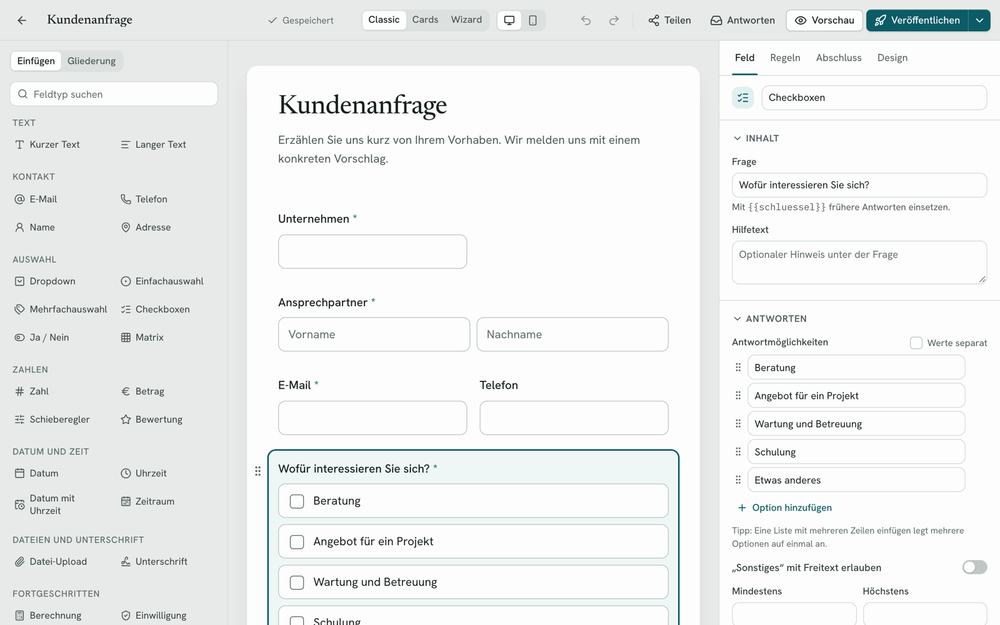
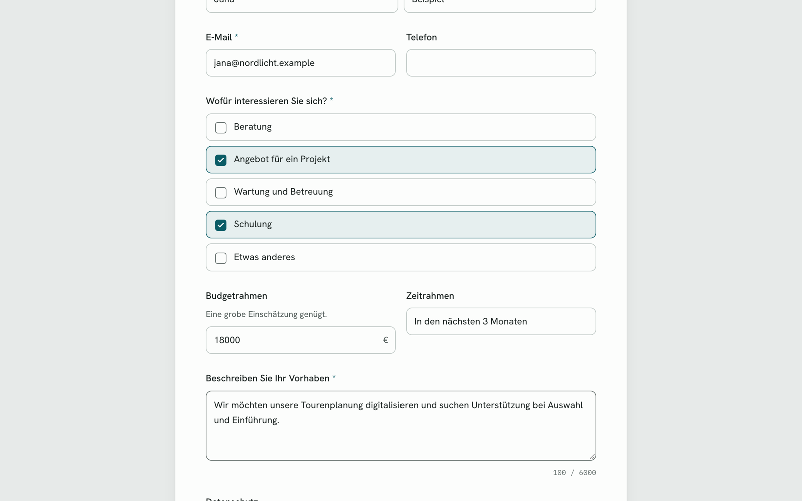
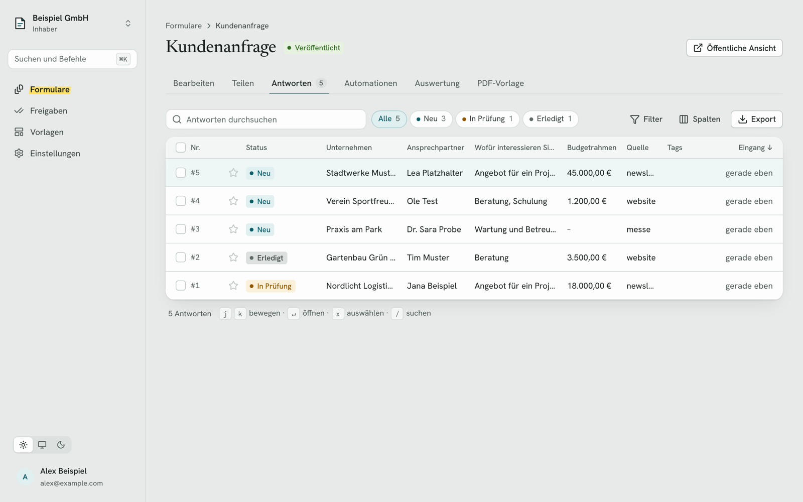
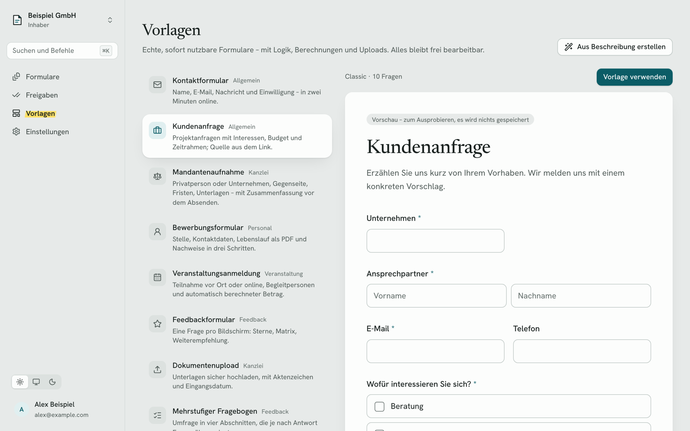
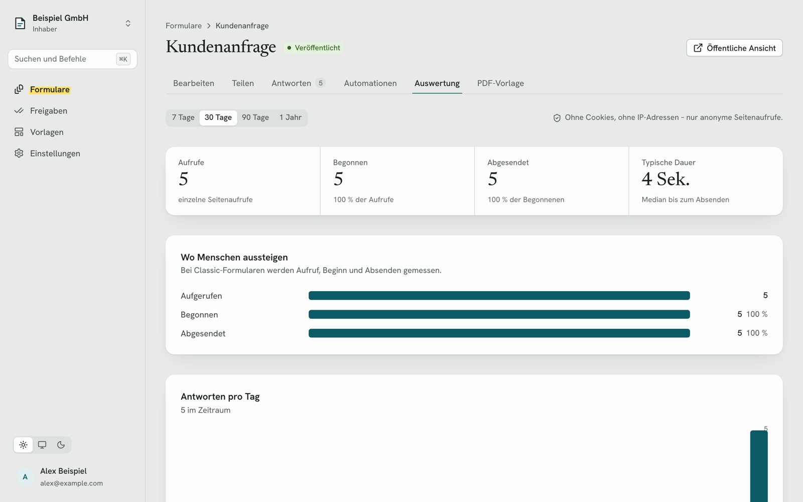

<picture>
  <source media="(prefers-color-scheme: dark)" srcset="docs/bilder/plica-logo-dunkel.svg">
  
</picture>

# PLICA

[](LICENSE)

**Online-Formulare bauen, veröffentlichen und auswerten, auf dem eigenen Server.**
PLICA ist eine kostenlose Formularplattform für Unternehmen, Praxen, Kanzleien,
Vereine und Verwaltungen. Kontaktformular, Kundenanfrage, Anmeldung, Bewerbung,
Datei-Upload oder Einwilligung mit Unterschrift: Sie bauen das Formular im
visuellen Editor, teilen es per Link, QR-Code oder auf Ihrer Website, und wer es
ausfüllt, braucht kein Konto. Die Antworten bearbeitet Ihr Team an einem Ort, mit
Status, Notizen, Export, PDF und Automationen.

PLICA braucht keine Cloud und kein Abo und sendet keine Daten an Dritte.
Formulare, Antworten und Dateien bleiben auf Ihrem Server. Die Auswertung zählt
Aufrufe ohne Cookies und ohne IP-Adressen.

*Plica* ist lateinisch für **Falz**, die Linie, an der ein Blatt umgeschlagen
wird. Im Editor ist genau das ein Seitenumbruch.

> **English abstract:** Self-hosted form builder and submission inbox. Visual
> editor with 30 field types (file upload, signature, matrix, repeat groups,
> calculations), conditional logic, three layouts (classic, one question per
> card, wizard), versioned publishing via link, QR code or embed, password and
> time windows. Submissions get status, tags, notes, history, saved views, CSV/XLSX/JSON
> export and PDF templates; automations send e-mails, signed webhooks and approval
> requests through a durable queue. Workspaces, five roles, TOTP, OIDC (e.g.
> authentik), REST API with OpenAPI, retention rules, ClamAV. Next.js 16,
> PostgreSQL 18, S3-compatible storage, Docker Compose. UI and documentation are
> in German.



## 📖 Handbuch

Die vollständige Anleitung steht im **[Handbuch](docs/handbuch/README.md)**,
verständlich für alle, die Formulare bauen und Antworten bearbeiten, mit eigenen
Kapiteln für die IT. Es reicht von den
[ersten Schritten](docs/handbuch/00-erste-schritte.md) über
[Formulare erstellen](docs/handbuch/02-formulare-erstellen.md),
[Logik und Berechnungen](docs/handbuch/03-logik.md) und
[Antworten bearbeiten](docs/handbuch/06-antworten.md) bis zu
[Automationen](docs/handbuch/08-automationen.md),
[Installation](docs/handbuch/20-installation.md) und
[Sicherung](docs/handbuch/23-sicherung.md). Jede Funktion mit Rolle und Fundstelle
listet die [Funktionsliste](docs/handbuch/29-funktionsliste.md). Die
durchgespielten Beispiele stammen aus dem Kanzleialltag (Mandantenaufnahme); die
Abläufe gelten für jede Organisation.

## Installation

PLICA ist eine Server-Anwendung: einmal installiert, arbeitet das ganze Team im
Browser. Sie läuft in Docker und braucht Docker Compose 2.24 oder neuer, `git`,
`openssl` und `curl`.

<details>
<summary><strong>🧪 Ausprobieren</strong> (auf dem eigenen Rechner mit Docker Desktop oder OrbStack)</summary>

```bash
git clone https://github.com/PBaumfalk/Plica.git plica
cd plica
scripts/install.sh
```

Das Skript prüft die Voraussetzungen, legt die Konfiguration mit neuen
Zufallsschlüsseln an, baut und startet alle Dienste und prüft den Betrieb. Am
Ende zeigt es:

```text
PLICA läuft.
  Ersteinrichtung: http://localhost:3000/einrichten
  Einrichtungscode: 1480-4759-7510
```

Adresse öffnen, Einrichtungscode eingeben, Konto anlegen, fertig. Weiter mit den
[ersten Schritten](docs/handbuch/00-erste-schritte.md).
</details>

<details>
<summary><strong>🖥️ Auf einem Server</strong> (für die IT: Linux, Docker Compose, Reverse Proxy)</summary>

```bash
git clone https://github.com/PBaumfalk/Plica.git /opt/plica
cd /opt/plica
scripts/install.sh --url https://formulare.example.de
```

Die App lauscht nur auf `127.0.0.1:3000`; davor gehört ein Reverse Proxy mit
TLS ([Beispiele für Caddy und nginx](docs/handbuch/22-reverse-proxy.md)).
Datenbank, Objektspeicher und Virenscanner liegen in einem internen Docker-Netz
ohne Internetzugang. Optional bekommen öffentliche Formulare eine eigene Domain,
während die Verwaltung intern bleibt. Ein zweiter Aufruf des Skripts behält
Konfiguration und Daten und dient auch für Updates (`git pull && scripts/install.sh`).
Einzelschritte von Hand, Konfiguration, Sicherung und Updates:
[Handbuch, Kapitel 20 bis 25](docs/handbuch/20-installation.md).
</details>

<details>
<summary><strong>🤖 Mit Claude Code</strong> (Installation im Gespräch)</summary>

Claude Code im Ordner `plica` öffnen und den
[Installationsprompt](docs/handbuch/19-installation-mit-claude-code.md#4-den-installationsprompt-einfügen)
einfügen. Claude prüft die Umgebung, installiert, kontrolliert den Start und nennt
Adresse und Einrichtungscode. Jeden Befehl zeigt Claude vorher an.
</details>

## Funktionen im Überblick

| Formular ausfüllen | Antworten bearbeiten |
| --- | --- |
|  |  |

- **Visueller Editor:** 30 Feldtypen von Name und Adresse über Betrag, Datum und
  Matrix bis Datei-Upload und Unterschrift; Drag-and-drop, Bausteine,
  Rückgängig, Versionen, Autosave mit Konfliktschutz
  ([Kapitel 2](docs/handbuch/02-formulare-erstellen.md))
- **Logik und Berechnungen ohne Programmierung:** Felder ein- und ausblenden,
  Pflicht je nach Antwort, Beträge berechnen, verschiedene Abschlussseiten, mit
  Prüfung auf Widersprüche ([Kapitel 3](docs/handbuch/03-logik.md))
- **Zehn Vorlagen** wie Kontaktformular, Kundenanfrage, Bewerbung,
  Veranstaltungsanmeldung, Feedback und Einwilligung; neue Formulare auch aus
  einer Beschreibung in einem Satz, optional mit eigener KI
  ([Kapitel 2](docs/handbuch/02-formulare-erstellen.md#aus-einer-vorlage))
- **Drei Darstellungen:** klassisch, eine Frage pro Karte oder Assistent mit
  Schritten; eigene Farbe, Schrift und Logo
  ([Kapitel 4](docs/handbuch/04-darstellung.md))
- **Teilen:** Link, QR-Code, Einbettung in die eigene Website, Passwort,
  Zeitfenster, Antwortlimit, später fortsetzen, Werte über den Link vorbelegen,
  Folgeformulare ([Kapitel 5](docs/handbuch/05-veroeffentlichen-teilen.md))
- **Antworten:** Tabelle mit Ansichten, Filtern und Tastaturbedienung,
  Detailansicht mit Status, Tags, internen Notizen und Verlauf; Uploads mit
  Inhaltsprüfung und Virenscan ([Kapitel 6](docs/handbuch/06-antworten.md))
- **Export und PDF:** XLSX, CSV und JSON, PDF je Antwort nach eigener Vorlage
  mit Prüfsumme ([Kapitel 7](docs/handbuch/07-export-pdf.md))
- **Automationen und Freigaben:** E-Mail an das Team, Eingangsbestätigung,
  Vier-Augen-Freigabe, signierte Webhooks an CRM, Ticketsystem oder
  Fachsoftware; eine dauerhafte Warteschlange führt jeden Schritt genau einmal
  aus ([Kapitel 8](docs/handbuch/08-automationen.md))
- **Schnittstelle:** REST-API mit OpenAPI-Beschreibung
  ([Integrationen](docs/handbuch/integrationen.md))
- **Für das Team:** Workspaces, fünf Rollen von Leser bis Inhaber,
  Einladungen, Zwei-Faktor-Anmeldung, Anmeldung über OIDC (z. B. authentik),
  Protokoll ([Kapitel 10](docs/handbuch/10-team-rollen.md),
  [11](docs/handbuch/11-workspaces.md))
- **Hell und dunkel, Smartphone und Tablet**, Befehlspalette (⌘K bzw. Strg+K)

| Vorlagen | Auswertung |
| --- | --- |
|  |  |

## Datenschutz und Sicherheit

- Keine Telemetrie und keine externen Dienste. Schriften und Programmteile
  liefert PLICA selbst aus; öffentliche Formulare setzen keine Tracking-Cookies.
- Aufbewahrungsfristen je Workspace oder Formular, danach endgültige Löschung
  einschließlich Dateien ([Kapitel 12](docs/handbuch/12-datenschutz-aufbewahrung.md)).
- Hochgeladene Dateien werden am Inhalt erkannt, nicht an der Endung, und mit
  ClamAV geprüft oder bis zur Freigabe in Quarantäne gehalten.
- Abgleich mit OWASP ASVS 5.0 ([Sicherheit](docs/sicherheit/asvs.md)),
  Hinweise für Betreiber in [Datenschutz](docs/datenschutz.md). Wo welche Daten
  liegen und wann sie den Server verlassen:
  [Architektur](docs/handbuch/26-architektur.md#wo-daten-liegen-und-wohin-sie-fließen).

## Für Entwickler

Next.js 16 (App Router) mit React 19 und TypeScript, PostgreSQL 18 über Drizzle,
S3-kompatibler Objektspeicher (RustFS), ein Worker mit dauerhafter Warteschlange
in PostgreSQL. Die Formular-Engine (`src/lib/forms/`) läuft ohne DOM und
Datenbank in Browser und Server gleich; der Server prüft verbindlich. Ein
Docker-Image für App, Worker und Kommandozeile. Aufbau:
[Architektur](docs/handbuch/26-architektur.md).

```bash
pnpm install
pnpm dev:init        # lokale Dev-Konfiguration anlegen (einmalig)
pnpm dev:services    # PostgreSQL, S3-Speicher und Mailpit auf 127.0.0.1:47xx
pnpm db:migrate
pnpm dev             # http://localhost:4700 – Einrichtungscode steht im Terminal
pnpm worker          # zweites Terminal: E-Mails, Webhooks, Automationen
pnpm test            # Unit- und Integrationstests
pnpm test:e2e        # Browser-Tests gegen einen Produktions-Build
pnpm test:lifecycle  # Docker-Image: Absturz, Sicherung, Wiederherstellung
pnpm docs:check      # Links und Anker in README und Handbuch
```

Mehr in [Tests](docs/handbuch/27-tests.md) und
[Bekannte Einschränkungen](docs/handbuch/28-bekannte-einschraenkungen.md).

## Lizenz

[MIT](LICENSE), © 2026 Patrick Baumfalk.

Mitgelieferte Schriften: Hanken Grotesk, Newsreader und IBM Plex Mono (SIL Open
Font License 1.1). Symbole aus [Lucide](https://lucide.dev) (ISC).

## Hinweis

PLICA ist ein Werkzeug; wer es betreibt, ist für die verarbeiteten Daten
verantwortlich. Datenschutzhinweise in Formularen und die Pflichten des
Betreibers ([Datenschutz](docs/datenschutz.md)) bitte vor dem Einsatz prüfen
bzw. prüfen lassen. Die elektronische Unterschrift ist eine einfache
elektronische Signatur, keine qualifizierte. Die Software wird ohne Gewähr
bereitgestellt (siehe [LICENSE](LICENSE)).
