# 0 · Erste Schritte

Dieses Kapitel bringt Sie in einer halben Stunde vom ersten Anmelden bis zur ersten bearbeiteten Mandatsanfrage. Es richtet sich an alle, die PLICA neu benutzen, besonders an Rechtsanwaltsfachangestellte (ReFas) und das Sekretariat.

Alle Namen, Adressen und Fälle in diesem Kapitel sind erfunden. Sie können den Ablauf genau so mit denselben Beispieldaten nachspielen.

**Inhalt**

- [Bevor es losgeht](#bevor-es-losgeht)
- [Der allererste Start](#der-allererste-start)
- [Einladung annehmen und anmelden](#einladung-annehmen-und-anmelden)
- [Die Willkommensseite](#die-willkommensseite)
- [Ihr erster Vorgang: eine Mandatsanfrage](#ihr-erster-vorgang-eine-mandatsanfrage)
- [Ergebnis kontrollieren](#ergebnis-kontrollieren)
- [Wenn etwas nicht klappt](#wenn-etwas-nicht-klappt)

## Bevor es losgeht

Sie brauchen:

- die **Adresse**, unter der Ihre Kanzlei PLICA betreibt, zum Beispiel `https://plica.example.de`. Die nennt Ihnen Ihre IT.
- ein **Konto**. Sie bekommen es über einen Einladungslink von einer Administratorin oder einem Administrator. Ist eine zentrale Anmeldung (SSO) eingerichtet, melden Sie sich mit Ihren gewohnten Kanzlei-Zugangsdaten an.
- einen aktuellen Browser (Chrome, Edge, Firefox oder Safari).

Was Sie in PLICA tun dürfen, bestimmt Ihre **Rolle**. Für den Ablauf in diesem Kapitel genügt **Bearbeiter**. Wer nur eingehende Anfragen bearbeitet, aber keine Formulare baut, braucht **Prüfer**. Alle Rollen erklärt [Kapitel 10](10-team-rollen.md#die-fünf-rollen).

Die Verwaltungsoberfläche spricht Sie mit „du“ an. Formulare für Mandantinnen und Mandanten verwenden „Sie“.

## Der allererste Start

Diesen Abschnitt erledigt einmalig die Person, die PLICA installiert hat. Alle anderen überspringen ihn.

Direkt nach der Installation gibt es noch kein Konto und kein Standardpasswort. PLICA leitet jede Adresse auf **PLICA einrichten** um und verlangt den **Einrichtungscode** aus dem Server-Protokoll. Das Installationsskript zeigt ihn am Ende an; sonst liefert ihn `docker compose exec app plica setup-code`.

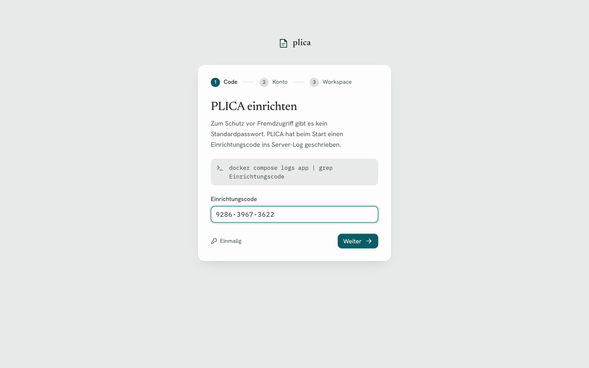

*Schritt 1 von 3 der Ersteinrichtung: Einrichtungscode eingeben.*

1. **Einrichtungscode** eingeben und **Weiter**.
2. **Dein Konto**: Name, E-Mail und Passwort (mindestens 10 Zeichen) der Inhaberin oder des Inhabers, im Beispiel „Dr. Anna Beispiel“, `anna.beispiel@example.de`. **Weiter**.
3. **Dein Workspace**: Name des ersten Arbeitsbereichs, meist der Kanzleiname, im Beispiel „Kanzlei Musterstadt“. **Einrichtung abschließen**.

Sie sind danach angemeldet und landen auf der [Willkommensseite](#die-willkommensseite). Der Code ist verbraucht. Richten Sie jetzt für dieses Konto unter **Einstellungen → Konto** die Zwei-Faktor-Anmeldung ein und laden Sie das Team ein:

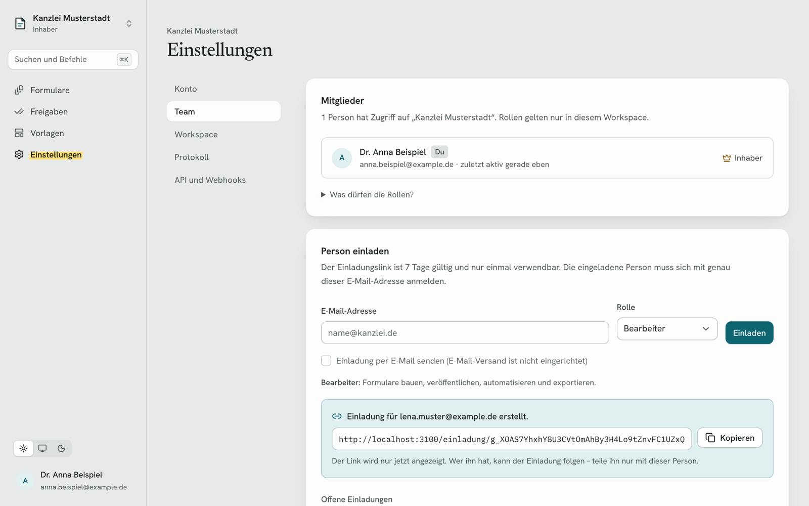

*Einstellungen → Team → Person einladen: Ohne E-Mail-Versand zeigt PLICA den Einladungslink einmalig zum Kopieren an.*

**Einstellungen → Team → Person einladen**: E-Mail-Adresse eingeben, Rolle wählen (für eine ReFa meist **Bearbeiter**), **Einladen**. Ist der E-Mail-Versand eingerichtet, setzen Sie vorher den Haken **Einladung per E-Mail senden**. Sonst kopieren Sie den angezeigten Link mit **Kopieren** und geben ihn der Person auf einem sicheren Weg weiter. Der Link wird nur dieses eine Mal angezeigt, gilt 7 Tage und nur für diese E-Mail-Adresse.

## Einladung annehmen und anmelden

1. Öffnen Sie den Einladungslink. Sie sehen, wer Sie in welchen Workspace mit welcher Rolle eingeladen hat.
2. Geben Sie **Name** und **Passwort** (mindestens 10 Zeichen) ein und klicken Sie **Konto anlegen und beitreten**.
3. Künftig melden Sie sich unter der Adresse Ihrer Kanzlei auf der Seite **Anmelden** mit E-Mail und Passwort an, bei SSO über den Knopf **Mit … anmelden**.

Haben Sie schon ein Konto (etwa aus einem anderen Workspace), melden Sie sich zuerst an und öffnen den Link danach erneut.

## Die Willkommensseite

Direkt nach der Ersteinrichtung begrüßt PLICA die Inhaberin mit einer Übersicht in drei Schritten (später jederzeit unter der Adresse `/willkommen` erreichbar): **Bauen**, **Teilen**, **Bearbeiten**.

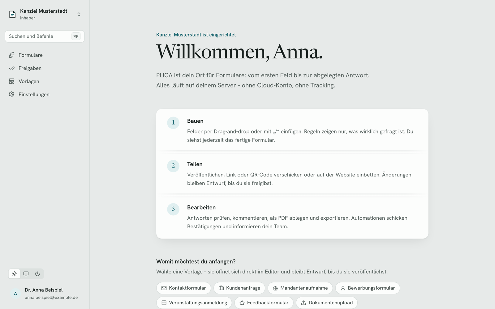

*Die Willkommensseite nach der Einrichtung.*

Unter **Womit möchtest du anfangen?** (ab Rolle Bearbeiter) öffnet ein Klick auf eine Vorlage, etwa **Mandantenaufnahme**, direkt den Editor. **Alle Vorlagen mit Vorschau** führt zur Seite **Vorlagen**, **Leeres Formular** zum leeren Editor.

**Alle zehn als Beispiele anlegen** legt alle zehn Vorlagen auf einmal als Entwürfe an. Das ist praktisch zum Ausprobieren und ungefährlich: Entwürfe sind von außen nicht erreichbar. Löschen Sie die Beispiele später über die Formularliste (**In den Papierkorb …**, ab Rolle Administrator).

Wie die Oberfläche aufgebaut ist, erklärt [Kapitel 1](01-ueberblick.md#die-oberfläche).

## Ihr erster Vorgang: eine Mandatsanfrage

Der Vorgang hat zwei Teile:

- **Teil A – einmalig:** Das Formular „Mandantenaufnahme“ wird bereitgestellt (Rolle Bearbeiter). Läuft es in Ihrer Kanzlei schon, springen Sie zu [Teil B](#teil-b--die-anfrage-bearbeiten).
- **Teil B – bei jeder Anfrage:** Eine Mandantin füllt das Formular aus. Sie prüfen und bearbeiten die Anfrage und legen sie als PDF zur Akte (ab Rolle Prüfer; für PDF und Ansehen genügt Leser).

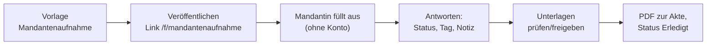

### Teil A – Formular bereitstellen

**1. Vorlage wählen.** Klicken Sie in der Seitenleiste auf **Vorlagen** und dann auf **Mandantenaufnahme**. Rechts sehen Sie eine Vorschau, in der Sie probehalber klicken können; dabei wird nichts gespeichert.

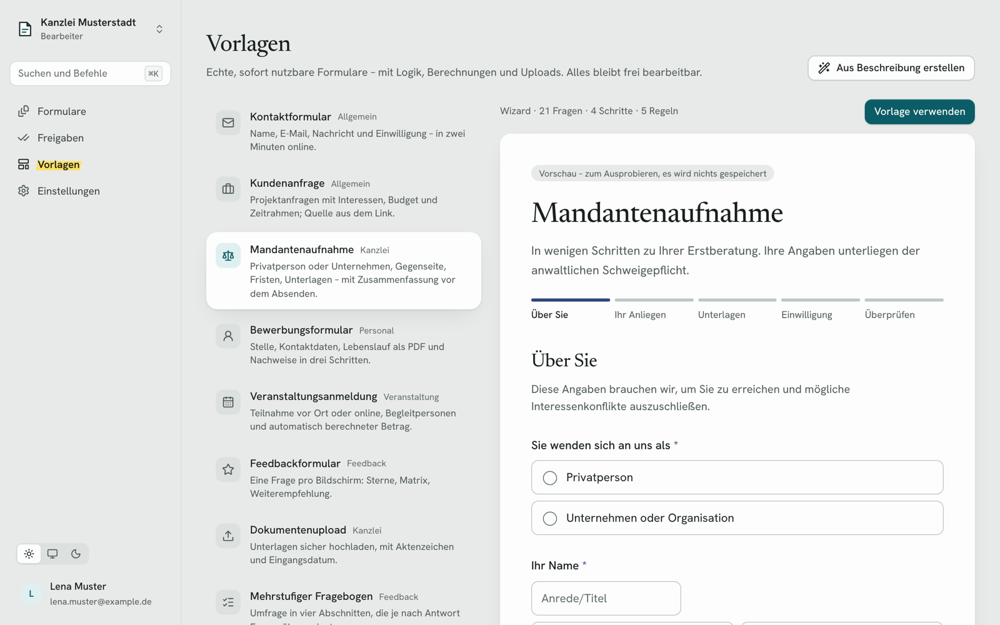

*Vorlagen → Mandantenaufnahme: vier Seiten (Über Sie, Ihr Anliegen, Unterlagen, Einwilligung) und eine Zusammenfassung vor dem Absenden.*

**2. Vorlage verwenden.** Klicken Sie **Vorlage verwenden**. PLICA legt einen Entwurf an und öffnet den Editor. Die Vorlage enthält bereits sinnvolle Regeln, zum Beispiel:

- Unternehmensdaten erscheinen nur, wenn „Unternehmen oder Organisation“ gewählt wird.
- Bei „Läuft eine Frist? – Ja“ fragt das Formular nach dem Fristende und zeigt am Ende eine Abschlussseite, die einen Rückruf am nächsten Werktag ankündigt.

Passen Sie Texte bei Bedarf an (Feld anklicken, rechts bearbeiten, siehe [Kapitel 2](02-formulare-erstellen.md#ein-feld-bearbeiten)). Für den ersten Durchlauf können Sie die Vorlage unverändert lassen. PLICA speichert automatisch; oben steht „Gespeichert“.

**3. Probe ansehen.** **Vorschau** (oder ⌘⇧P / Strg+Umschalt+P) zeigt das Formular so, wie Mandantinnen und Mandanten es sehen. In der Vorschau wird nichts gespeichert.

**4. Veröffentlichen.** Klicken Sie oben rechts **Veröffentlichen**. PLICA prüft das Formular vorher auf Fehler. Ist alles in Ordnung, erscheint **Dein Formular ist online**.

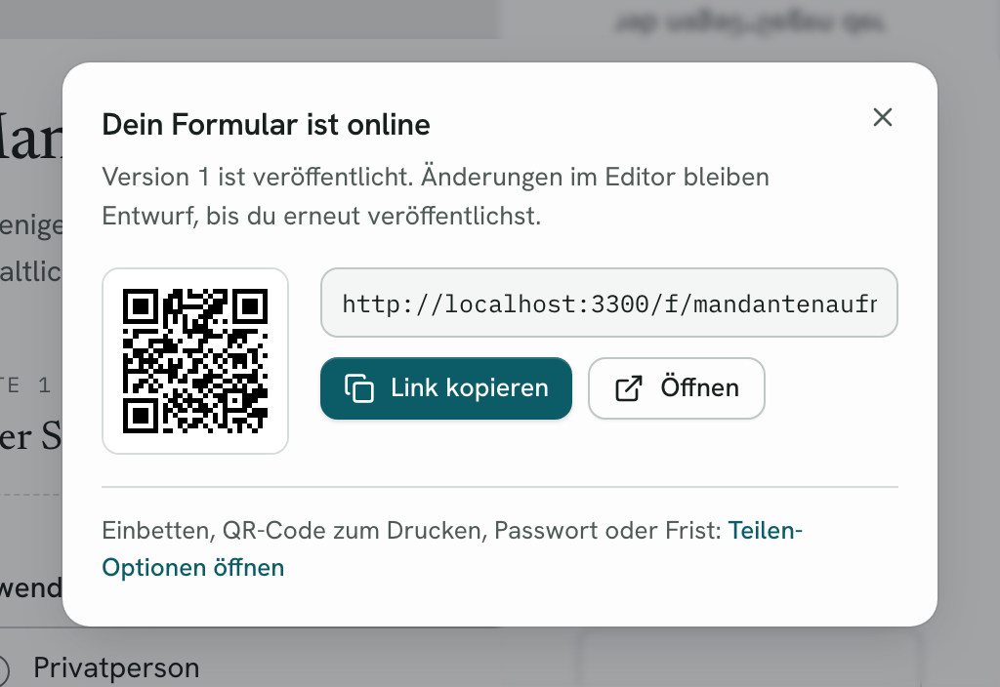

*Nach dem Veröffentlichen: Version 1 ist öffentlich, der Link lässt sich kopieren.*

**5. Link weitergeben.** **Link kopieren** legt die Adresse in die Zwischenablage, etwa `https://plica.example.de/f/mandantenaufnahme`. Setzen Sie sie auf die Kanzlei-Website, in die E-Mail-Signatur oder schicken Sie sie einer Mandantin. QR-Code, Einbettung, Passwortschutz und Zeitfenster finden Sie im Reiter **Teilen** ([Kapitel 5](05-veroeffentlichen-teilen.md)).

Spätere Änderungen im Editor bleiben Entwurf, bis Sie erneut veröffentlichen. Bereits eingegangene Antworten bleiben ihrer Version zugeordnet.

### Teil B – die Anfrage bearbeiten

**6. Die Mandantin füllt aus.** Zum Üben füllen Sie das Formular selbst aus: Öffnen Sie den Link in einem privaten Browserfenster und verwenden Sie diese Beispieldaten.

| Feld | Beispielwert |
|---|---|
| Sie wenden sich an uns als | Privatperson |
| Ihr Name | Erika Mustermann |
| E-Mail / Telefon | `erika.mustermann@example.de` / 0151 23456789 |
| Anschrift | Beispielweg 12, 12345 Musterstadt |
| Rechtsgebiet | Arbeitsrecht |
| Gegenseite | Muster Logistik GmbH |
| Was ist passiert? | Ich bin seit 2019 als Lageristin beschäftigt. Am 17.11.2026 habe ich die schriftliche Kündigung zum 31.01.2027 erhalten, ohne Abmahnung vorher. |
| Was möchten Sie erreichen? | Ich möchte meinen Arbeitsplatz behalten, notfalls eine Abfindung. |
| Läuft eine Frist? / Wann endet die Frist? | Ja / 08.12.2026 |
| Um welchen Betrag geht es ungefähr? | 9600 |
| Rechtsschutzversicherung | Nein |
| Unterlagen | eine beliebige PDF-Datei, z. B. ein Scan des Kündigungsschreibens |
| Einwilligung | Datenschutz angehakt, Kommunikation per E-Mail angehakt |

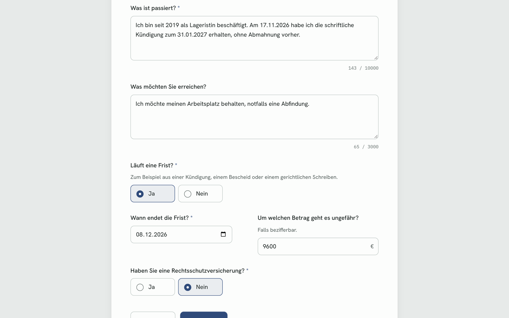

*Die Mandantin sieht die Kanzlei-Ansicht nie, nur dieses Formular. Mit „Ja“ bei der Frist erscheint das Feld „Wann endet die Frist?“.*

Mit **Weiter** geht es durch die Schritte bis **Überprüfen**. Dort sieht die Mandantin alle Angaben noch einmal und sendet mit **Anfrage verbindlich senden** ab. Weil eine Frist läuft, erscheint die eilige Abschlussseite:

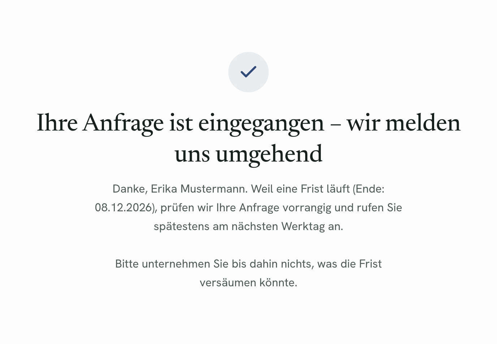

*Abschlussseite für Anfragen mit laufender Frist: Name und Fristende werden aus den Antworten eingesetzt.*

**7. Die Anfrage finden.** Öffnen Sie in PLICA **Formulare → Mandantenaufnahme → Antworten**. Neue Anfragen stehen oben mit dem Status **Neu**. Die Zahl am Reiter zeigt, wie viele Antworten es gibt.

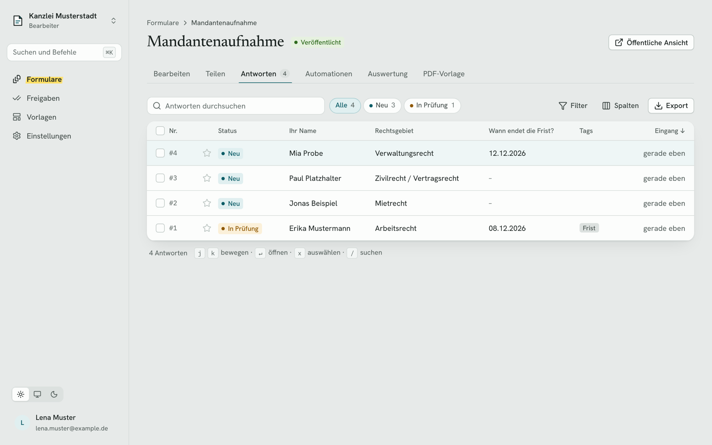

*Antworten: Über „Spalten“ sind hier „Ihr Name“, „Rechtsgebiet“ und „Wann endet die Frist?“ eingeblendet. Die Anfrage von Erika Mustermann ist schon in Prüfung und als „Frist“ markiert.*

Tipp: Unter **Spalten** wählen Sie, welche Felder die Tabelle zeigt. Für die Mandantenaufnahme bewähren sich **Ihr Name**, **Rechtsgebiet** und **Wann endet die Frist?**. Die Auswahl merkt sich Ihr Browser. Mit den Status-Knöpfen über der Tabelle (**Alle**, **Neu**, …) filtern Sie; mehr in [Kapitel 6](06-antworten.md#suchen-filtern-sortieren).

**8. Anfrage öffnen und übernehmen.** Klicken Sie auf die Zeile von Erika Mustermann. Links bleibt die Liste, rechts sehen Sie alle Angaben, gegliedert nach den Seiten des Formulars.

1. **Status setzen:** Klicken Sie auf **Neu ˅** neben „Antwort #1“ und wählen Sie **In Prüfung** (oder Taste **2**). So sieht das Team, dass sich jemand kümmert.
2. **Markieren:** Tippen Sie rechts unter **Tags** in **Tag hinzufügen …** das Wort `Frist` und drücken Sie Enter. Über diesen Tag finden Sie fristgebundene Anfragen später mit dem Filter.
3. **Notiz schreiben:** Unter **Interne Notizen**, zum Beispiel „Frist 08.12.2026 (Klagefrist § 4 KSchG) im Fristenkalender notiert. Rückruf mit Frau Mustermann am 21.11., 10 Uhr.“ und **Notiz speichern**. Notizen sieht nur das Team, nie die Mandantin.

> **Wichtig:** PLICA berechnet und überwacht keine Fristen. Das Fristende ist die Angabe der Mandantin. Tragen Sie die Frist wie gewohnt im Fristenkalender Ihrer Kanzleisoftware ein und lassen Sie sie durch die zuständige Anwältin oder den zuständigen Anwalt prüfen.

**9. Unterlagen öffnen.** Unter **Unterlagen** steht die hochgeladene Datei mit ihrem Prüfstatus.

- **virengeprüft**: Die Datei lässt sich mit **Öffnen** oder **Laden** sofort verwenden.
- **Quarantäne – nicht auf Viren geprüft**: Ihre Kanzlei betreibt keinen Virenscanner, oder er war beim Upload nicht erreichbar. Versuchen Sie zuerst **Jetzt prüfen**. Bleibt die Datei ungeprüft und vertrauen Sie dem Absender, wählen Sie **Ungeprüft freigeben …** und bestätigen mit **Trotzdem freigeben** (ab Rolle Bearbeiter). Die Freigabe wird protokolliert.

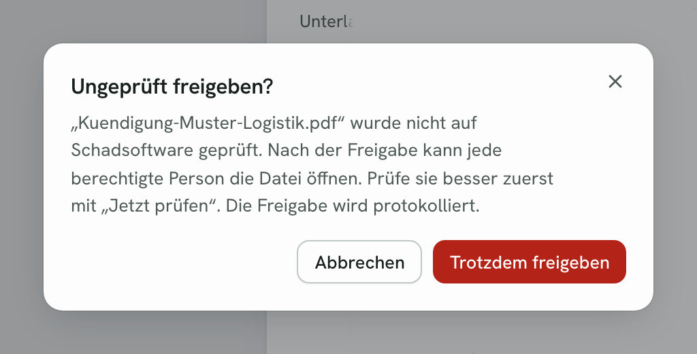

*Ohne Virenscanner muss eine Datei bewusst freigegeben werden, bevor sie sich öffnen lässt.*

Danach sieht die Anfrage so aus. Jede Änderung steht mit Person und Zeitpunkt im **Verlauf**:

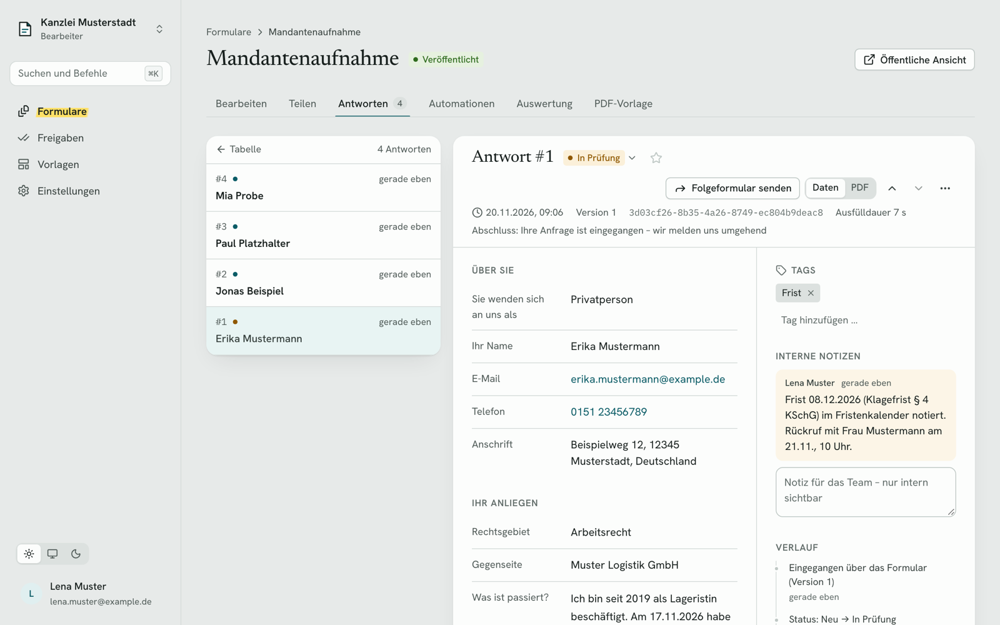

*Bearbeitete Anfrage: Status „In Prüfung“, Tag „Frist“, interne Notiz und Verlauf rechts.*

**10. PDF für die Akte.** Schalten Sie oben rechts von **Daten** auf **PDF** (oder Taste **P**). Sie sehen die Anfrage als PDF. Über **⋯ → PDF herunterladen** speichern Sie die Datei, im Beispiel `mandantenaufnahme-antwort-1.pdf`, und legen sie in Ihrer Kanzleisoftware zur Akte. Das PDF enthält Kanzlei, Eingangszeitpunkt, Version, Status und alle Angaben.

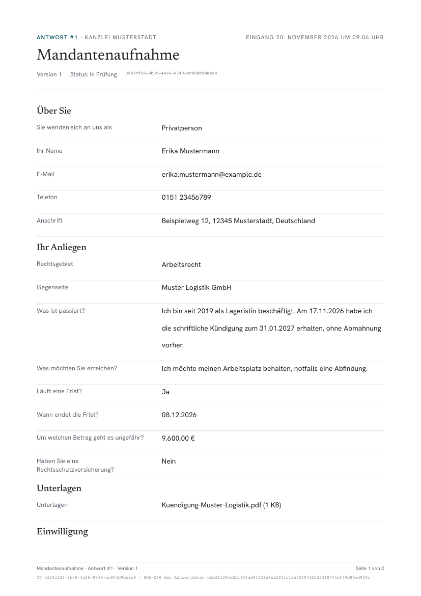

*Das Ergebnis: das PDF der Anfrage, bereit für die Akte.*

**11. Übergeben und abschließen.** Die Anwältin oder der Anwalt prüft die Anfrage (siehe [Kapitel 9](09-kanzleiablaeufe.md#ergebnis-prüfen)). Ist das Mandat angelegt und die Anfrage vollständig übernommen, setzen Sie den Status auf **Erledigt** (Taste **5**).

## Ergebnis kontrollieren

Ihr erster Vorgang ist abgeschlossen, wenn:

- die Anfrage unter **Antworten** mit Status **In Prüfung** und später **Erledigt** steht,
- der **Verlauf** Statuswechsel, Tag, Notiz und gegebenenfalls die Dateifreigabe zeigt,
- das PDF in der Akte liegt und die Frist im Fristenkalender der Kanzlei eingetragen ist.

## Wenn etwas nicht klappt

| Problem | Ursache und Lösung |
|---|---|
| Ein Knopf aus dieser Anleitung fehlt | Ihre Rolle reicht nicht. Formulare bauen und veröffentlichen ab **Bearbeiter**, Status und Notizen ab **Prüfer**. Bitten Sie eine Administratorin um eine andere Rolle. |
| Der Link zeigt „Seite nicht gefunden“ | Das Formular ist noch nicht veröffentlicht. **Veröffentlichen** im Editor klicken. |
| Der Link zeigt „Dieses Formular nimmt vorübergehend keine Antworten an.“ | Das Formular ist pausiert. Reiter **Teilen → Wieder öffnen**. |
| Die Mandantin kann nicht absenden | Pflichtfelder (mit *) fehlen; das Formular markiert sie rot. Sehr schnelles Absenden (unter 2,5 Sekunden) blockiert der Spam-Schutz. |
| Die Tabelle zeigt nicht die gewünschten Felder | **Spalten** öffnen und Felder an- oder abwählen. |
| Datei lässt sich nicht öffnen | Sie liegt in Quarantäne. **Jetzt prüfen** oder **Ungeprüft freigeben …** (siehe Schritt 9). |
| Keine E-Mails kommen an | Der E-Mail-Versand ist nicht eingerichtet. Das erledigt die IT ([Kapitel 21](21-konfiguration.md#e-mail)). |

← [Handbuch](README.md) · weiter: [Überblick](01-ueberblick.md) →
