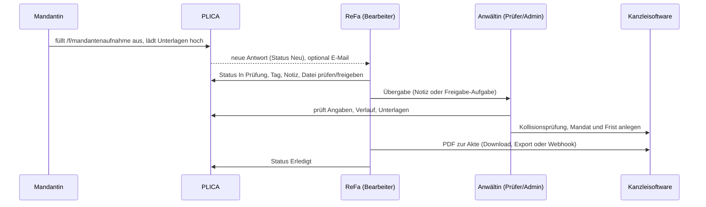
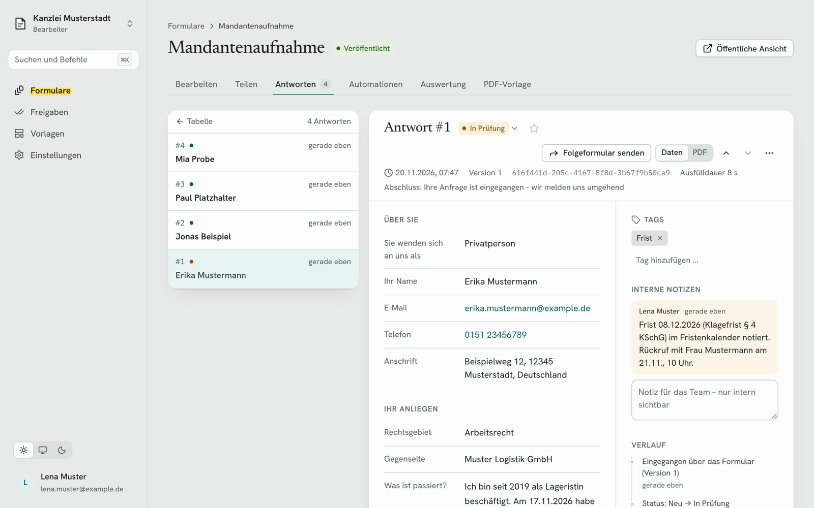
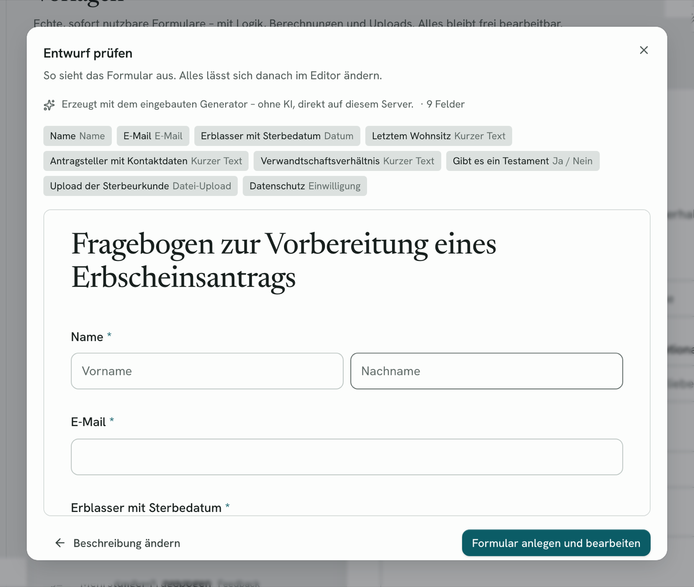

# 9 · Kanzleiabläufe: prüfen und weiterverwenden

Dieses Kapitel ist für Rechtsanwältinnen, Rechtsanwälte und ReFas. Es beschreibt, wer in einem typischen Mandatsablauf welche Schritte in PLICA erledigt, wie Sie ein Formularergebnis kontrollieren und wie es in Akte und Kanzleisoftware gelangt. Die einzelnen Bedienschritte stehen in [Erste Schritte](00-erste-schritte.md#ihr-erster-vorgang-eine-mandatsanfrage) und in den Fachkapiteln.

**Inhalt**

- [Wer macht was](#wer-macht-was)
- [Der Ablauf einer Mandatsanfrage](#der-ablauf-einer-mandatsanfrage)
- [Ergebnis prüfen](#ergebnis-prüfen)
- [Ergebnis weiterverwenden](#ergebnis-weiterverwenden)
- [Vier-Augen-Prinzip mit Freigaben](#vier-augen-prinzip-mit-freigaben)
- [Formular aus einer Beschreibung erzeugen (mit oder ohne KI)](#formular-aus-einer-beschreibung-erzeugen-mit-oder-ohne-ki)
- [Was PLICA nicht übernimmt](#was-plica-nicht-übernimmt)

## Wer macht was

PLICA kennt fünf Rollen je Workspace ([Kapitel 10](10-team-rollen.md#die-fünf-rollen)). In Kanzleien hat sich diese Zuordnung bewährt:

| Person | Empfohlene Rolle | Typische Aufgaben in PLICA |
|---|---|---|
| Kanzleiinhaber/in | Inhaber | Team und Rollen, Aufbewahrungsfristen, Workspaces; alles Weitere wie Administrator |
| Anwältin, Anwalt | Administrator oder Prüfer | Anfragen prüfen, Freigaben entscheiden (Mandat annehmen/ablehnen), Antworten löschen (nur Administrator) |
| ReFa, Sekretariat | Bearbeiter | Formulare aus Vorlagen anlegen und veröffentlichen, Anfragen bearbeiten, Dateien freigeben, Export und PDF, Automationen |
| Auszubildende, Aushilfe | Prüfer oder Leser | Anfragen sichten (Leser) oder zusätzlich Status, Tags und Notizen setzen (Prüfer) |
| IT, externer Dienstleister | Administrator, besser nur Server-Zugang | Installation, Sicherung und Updates laufen auf dem Server ([Kapitel 20](20-installation.md)); in PLICA selbst ist dafür kein Konto nötig |

Was eine Rolle genau darf, zeigt **Einstellungen → Team → Was dürfen die Rollen?**. Der Server prüft jede Aktion; fehlende Knöpfe bedeuten fehlende Rechte.

## Der Ablauf einer Mandatsanfrage

| Schritt | Wer | Eingaben | Ergebnis in PLICA |
|---|---|---|---|
| Anfrage geht ein | Mandantin, ohne Konto | Formularangaben, Uploads, Einwilligungen | Antwort mit Status **Neu**, Eintrag „Eingegangen über das Formular (Version n)“ im Verlauf |
| Sichten und übernehmen | ReFa (ab Prüfer) | Status, Tags, interne Notiz | Status **In Prüfung**, Tag z. B. `Frist`, Notiz mit Namen und Zeit |
| Unterlagen prüfen | ReFa (ab Bearbeiter) | „Jetzt prüfen“ oder „Ungeprüft freigeben …“ | Datei **virengeprüft** oder „ohne Virenprüfung freigegeben“ (protokolliert) |
| Prüfen und entscheiden | Anwältin (ab Prüfer) | Kontrolle laut [Ergebnis prüfen](#ergebnis-prüfen); bei Freigaben Kommentar oder Begründung | Notiz oder Status **Freigegeben** / **Abgelehnt** |
| Zur Akte | ReFa (PDF ab Leser, Export ab Bearbeiter) | – | PDF-Datei bzw. XLSX/CSV/JSON; mit Automation automatisch |
| Abschließen | ReFa | Status | **Erledigt**; Löschung nach der eingestellten Aufbewahrungsfrist |

## Ergebnis prüfen

Öffnen Sie die Antwort unter **Formulare → *Formular* → Antworten**. Kontrollieren Sie vor der Übernahme in die Akte:

*Die Detailansicht enthält alles, was Sie für die Kontrolle brauchen: Kopfzeile, Angaben nach Formularseiten, Notizen und Verlauf.*

1. **Kopfzeile.** Eingangszeit, **Version** des Formulars, Antwort-ID, **Ausfülldauer** und welche **Abschlussseite** die Mandantin gesehen hat. Hat sie die eilige Abschlussseite gesehen („… wir melden uns umgehend“), wurde ihr ein Rückruf am nächsten Werktag angekündigt.
2. **Angaben.** Gegliedert nach den Seiten des Formulars. Ausgeblendete Felder (etwa Unternehmensdaten bei Privatpersonen) erscheinen nicht. Achten Sie auf die **Gegenseite** für die Kollisionsprüfung und auf Datumsangaben wie das **Fristende**: Das sind Angaben der Mandantin, keine geprüften Daten.
3. **Unterlagen.** Der Prüfstatus steht an jeder Datei. „virengeprüft“ heißt: ClamAV hat die Datei geprüft. „ohne Virenprüfung freigegeben“ heißt: Jemand aus dem Team hat sie bewusst freigegeben; wer, steht im Verlauf. PLICA prüft den tatsächlichen Dateiinhalt, nicht nur die Endung.
4. **Einwilligungen.** „Zugestimmt“ bzw. nicht zugestimmt je Einwilligungsfeld, etwa zur unverschlüsselten E-Mail-Kommunikation. Halten Sie sich daran.
5. **Unterschrift**, falls das Formular eine hat: Sie ist eine **einfache elektronische Signatur** (gezeichnetes Bild), keine qualifizierte. Wo die Schriftform gesetzlich verlangt ist, ersetzt sie die eigenhändige Unterschrift nicht ([Datenschutz](../datenschutz.md#technische-möglichkeiten)).
6. **Verlauf und Notizen.** Wer hat wann den Status geändert, Tags gesetzt, Dateien freigegeben, Notizen geschrieben, Freigaben entschieden? Der Verlauf lässt sich nicht bearbeiten.
7. **PDF-Kontrolle.** Mit **Daten | PDF** (Taste **P**) sehen Sie genau das Dokument, das zur Akte geht. Jede Seite trägt unten Antwort-ID und eine SHA-256-Prüfsumme der Antwortdaten. Ein später erneut erzeugtes PDF derselben Antwort trägt dieselbe Prüfsumme; so lässt sich zeigen, dass die Angaben seit dem Eingang nicht verändert wurden ([Kapitel 7](07-export-pdf.md#das-eingebaute-layout)).

Fällt Ihnen etwas auf, schreiben Sie eine **interne Notiz**, bevor Sie den Status ändern. Fehlen Angaben, schicken Sie der Mandantin über **Folgeformular senden** den Link zu einem weiteren veröffentlichten Formular, das mit den bekannten Angaben vorausgefüllt ist ([Kapitel 5](05-veroeffentlichen-teilen.md#folgeformular-senden)).

## Ergebnis weiterverwenden

| Weg | Wofür | Wo | Wer | Kapitel |
|---|---|---|---|---|
| **PDF herunterladen** | einzelne Anfrage zur Akte | Antwort → **⋯ → PDF herunterladen** oder **PDF**-Ansicht | ab Leser | [7](07-export-pdf.md#pdf-je-antwort) |
| **PDF-Vorlage** | eigener Aufnahmebogen mit Kanzleilogo, nur ausgewählte Felder | Reiter **PDF-Vorlage** | ab Bearbeiter | [7](07-export-pdf.md#beispiel-aufnahmebogen-für-die-akte) |
| **Export** XLSX, CSV, JSON | Listen, Statistik, Übernahme in andere Programme | Antworten → **Export** | ab Bearbeiter | [7](07-export-pdf.md#export) |
| **Automation „PDF erzeugen“** | PDF liegt automatisch an jeder Antwort | Reiter **Automationen** | ab Bearbeiter | [8](08-automationen.md#pdf-erzeugen) |
| **Webhook** | Daten signiert an die Kanzleisoftware übergeben, z. B. Kontakt und Akte in j-lawyer anlegen | Automation **An anderes System senden** | ab Bearbeiter, Einrichtung durch IT | [8](08-automationen.md#beispiel-mandantenaufnahme-mit-freigabe-und-übergabe-an-j-lawyer), [Integrationen](integrationen.md#beispiel-mandantenaufnahme-an-j-lawyer-im-lan) |
| **REST-API** | andere Programme holen Antworten, PDFs und Dateien ab und setzen Status oder Tags | **Einstellungen → API und Webhooks** | Schlüssel ab Administrator | [Integrationen](integrationen.md#rest-api) |
| **E-Mail an das Team** | Benachrichtigung bei neuer Antwort | Reiter **Teilen → Benachrichtigung** oder Automation | ab Bearbeiter, SMTP nötig | [5](05-veroeffentlichen-teilen.md#e-mail-bei-neuer-antwort) |

Nach der Übernahme setzen Sie den Status auf **Erledigt**. Die Antwort bleibt in PLICA, bis die Aufbewahrungsfrist des Formulars oder Workspace sie löscht ([Kapitel 12](12-datenschutz-aufbewahrung.md#aufbewahrungsfristen-einstellen)). Liegt die Anfrage vollständig in der Akte, ist eine kurze Frist (etwa 90 Tage) sinnvoll.

## Vier-Augen-Prinzip mit Freigaben

Soll eine Anwältin jede Anfrage ausdrücklich annehmen oder ablehnen, legen Sie im Reiter **Automationen** die Vorlage **Prüfen und freigeben** an. Jede neue Antwort erzeugt dann eine Aufgabe unter **Freigaben** in der Seitenleiste:

- **Freigeben** (Kommentar optional) setzt den Status **Freigegeben** und kann weitere Automationen starten, etwa die Übergabe an die Kanzleisoftware.
- **Ablehnen** verlangt eine **Begründung** und setzt **Abgelehnt**.

Entscheiden darf nur, wer mindestens Prüfer ist und mindestens die Rolle hat, für die die Freigabe bestimmt ist. Jede Entscheidung steht mit Person, Zeit und Kommentar im Verlauf. Einzelheiten und ein vollständiges Beispiel: [Kapitel 8](08-automationen.md#freigaben).

## Formular aus einer Beschreibung erzeugen (mit oder ohne KI)

PLICA kann aus einem Satz einen Formularentwurf bauen. Das ist die einzige Stelle, an der optional eine KI beteiligt ist.

**So geht es** (ab Bearbeiter): **Vorlagen → Aus Beschreibung erstellen** oder **Neues Formular → Aus Beschreibung …**. Beschreiben Sie Zweck und Felder in einem Satz, etwa:

> Fragebogen zur Vorbereitung eines Erbscheinsantrags: Erblasser mit Sterbedatum und letztem Wohnsitz, Antragsteller mit Kontaktdaten, Verwandtschaftsverhältnis, gibt es ein Testament (ja/nein), Upload der Sterbeurkunde, Einwilligung Datenschutz.

**Entwurf erzeugen** zeigt den Dialog **Entwurf prüfen** mit Feldliste und Vorschau:

*Entwurf prüfen: Die Zeile über der Feldliste nennt, wer den Entwurf erzeugt hat – hier der eingebaute Generator ohne KI.*

| | Ohne KI (Standard) | Mit KI (nur wenn die IT sie anbindet) |
|---|---|---|
| Welche Daten fließen ein | nur Ihr Beschreibungstext | nur Ihr Beschreibungstext (höchstens 4000 Zeichen) |
| Wohin | bleibt auf dem PLICA-Server, regelbasierter Generator | wird an den von der IT konfigurierten Dienst `AI_BASE_URL` gesendet, etwa ein lokales Ollama im Kanzleinetz oder einen externen Anbieter |
| Was zurückkommt | Formularentwurf | eine einfache Feldliste (Titel, Feldtypen, Beschriftungen, Pflicht, Optionen); PLICA baut daraus den Entwurf und prüft ihn wie jeden anderen |
| Hinweis im Dialog | „Erzeugt mit dem eingebauten Generator – ohne KI, direkt auf diesem Server.“ | „Erzeugt mit der konfigurierten KI.“ Bei Fehlern übernimmt automatisch der eingebaute Generator, mit Hinweis |
| Antworten von Mandanten | fließen nie ein | fließen nie ein |

**Wo das Team prüft:** Der Entwurf ist nie sofort öffentlich.

1. Im Dialog **Entwurf prüfen** kontrollieren Sie Felder und Typen; **Beschreibung ändern** führt zurück.
2. **Formular anlegen und bearbeiten** legt einen Entwurf an. Im Editor korrigieren Sie Beschriftungen (im Beispiel etwa „Letztem Wohnsitz“ zu „Letzter Wohnsitz“), ergänzen Regeln und Hinweise.
3. **Vorschau** zeigt das Formular aus Sicht der Mandantin.
4. **Veröffentlichen** prüft das Formular erneut auf Fehler und Widersprüche. Erst danach ist es erreichbar.

Schreiben Sie keine Mandantendaten in die Beschreibung. Bei einer angebundenen externen KI ist das eine Weitergabe an Dritte. Die Einrichtung beschreibt [Kapitel 21](21-konfiguration.md#ki-unterstützung-optional).

## Was PLICA nicht übernimmt

- **Fristen:** PLICA berechnet, überwacht und erinnert keine Fristen. Ein Datum im Formular ist eine Angabe der Mandantin. Fristen gehören in den Fristenkalender der Kanzleisoftware und werden anwaltlich geprüft.
- **Kollisionsprüfung:** PLICA fragt die Gegenseite ab, gleicht sie aber nicht mit Ihrem Mandatsbestand ab. Das geschieht in der Kanzleisoftware.
- **Mandatsvertrag:** Die Vorlage „Mandantenaufnahme“ stellt klar, dass durch das Formular noch kein Mandat zustande kommt.
- **Aktenführung:** PLICA ist ein Eingangskanal. Die Akte führt Ihre Kanzleisoftware; PLICA übergibt PDF, Export oder Webhook.
- **Qualifizierte Signatur, beA:** gibt es in PLICA nicht.

← [Automationen](08-automationen.md) · weiter: [Team und Rollen](10-team-rollen.md) →
