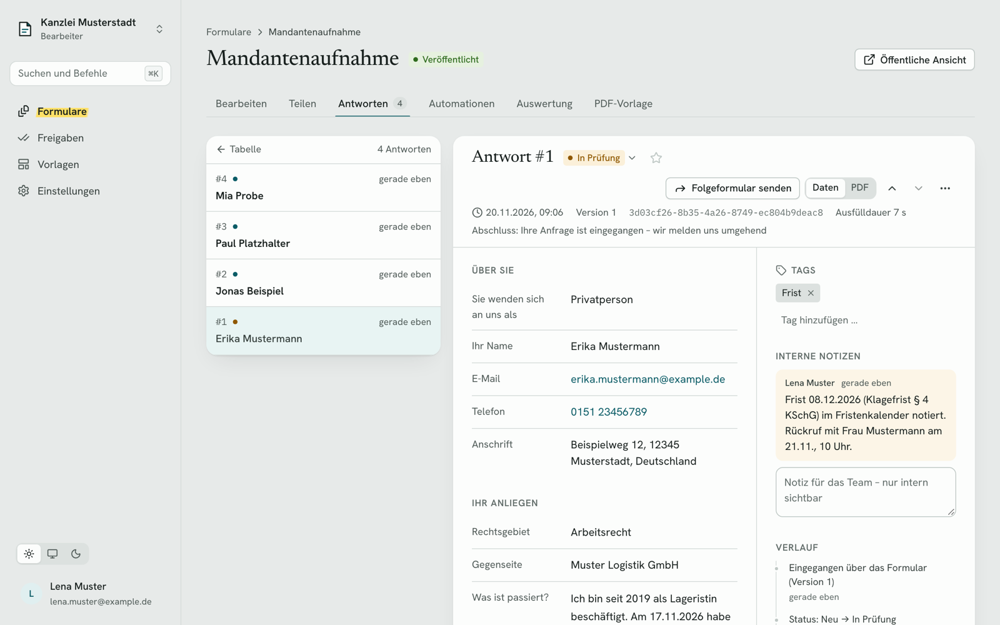

# PLICA – Handbuch

PLICA ist die selbst gehostete Formularplattform für Kanzleien: Mandantinnen und Mandanten füllen Formulare ohne Konto aus, das Kanzleiteam prüft die Antworten an einem Ort und übernimmt sie als PDF, Export oder per Schnittstelle in die Akte.

Dieses Handbuch beschreibt den ausgelieferten Stand. Alle Beispieldaten sind erfunden.

## Wo fangen Sie an?

| Sie sind … | Ihr Einstieg | Danach |
|---|---|---|
| **neu in PLICA** | [0 · Erste Schritte](00-erste-schritte.md) – Anmelden, Oberfläche, Ihr erster Vorgang mit Beispieldaten | [1 · Überblick](01-ueberblick.md) |
| **ReFa oder Sekretariat** | [Ihr erster Vorgang](00-erste-schritte.md#ihr-erster-vorgang-eine-mandatsanfrage) | [6 · Antworten bearbeiten](06-antworten.md), [7 · Export und PDF](07-export-pdf.md) |
| **Rechtsanwältin oder Rechtsanwalt** | [9 · Kanzleiabläufe: prüfen und weiterverwenden](09-kanzleiablaeufe.md) | [8 · Freigaben](08-automationen.md#freigaben), [12 · Aufbewahrung](12-datenschutz-aufbewahrung.md) |
| **Admin oder IT** | [19 · Installation mit Claude Code](19-installation-mit-claude-code.md) oder [20 · Installation](20-installation.md) | [21 · Konfiguration](21-konfiguration.md) bis [25 · Betrieb](25-betrieb-cli.md) |

*Eine bearbeitete Mandatsanfrage: links die Liste, Mitte die Angaben der Mandantin, rechts Tags, Notizen und Verlauf.*

## Teil A – Arbeiten mit PLICA

0. [Erste Schritte](00-erste-schritte.md) – Erststart, Einladung, Willkommensseite, der erste Vorgang Schritt für Schritt
1. [Überblick](01-ueberblick.md) – Anmeldung, Oberfläche, Rollen, der Weg eines Formulars, Befehlspalette
2. [Formulare erstellen](02-formulare-erstellen.md) – Editor, Feldtypen, Vorlagen, aus Beschreibung, Bausteine, Versionen
3. [Bedingte Logik und Berechnungen](03-logik.md) – Regeln, Abschlussseiten, Formeln
4. [Darstellung: Classic, Cards, Wizard](04-darstellung.md) – Anzeigemodi, Farben, Schrift, Vorschau
5. [Veröffentlichen und Teilen](05-veroeffentlichen-teilen.md) – Link, QR-Code, Einbettung, Passwort, Fristen, Folgeformulare
6. [Antworten bearbeiten](06-antworten.md) – Tabelle, Detailansicht, Status, Notizen, Dateien, Ansichten, Auswertung
7. [Export und PDF](07-export-pdf.md) – XLSX, CSV, JSON, PDF und PDF-Vorlagen
8. [Automationen und Freigaben](08-automationen.md) – E-Mails, Webhooks, Freigaben, Zustellprobleme
9. [Kanzleiabläufe: prüfen und weiterverwenden](09-kanzleiablaeufe.md) – wer macht was, Ergebnis kontrollieren, zur Akte, KI-Funktion

## Teil B – Administration

10. [Team und Rollen](10-team-rollen.md) – Rollen, Einladungen, Inhaberschaft, Rollen aus SSO-Gruppen, Protokoll
11. [Workspaces](11-workspaces.md) – mehrere Bereiche in einer Installation
12. [Datenschutz und Aufbewahrung](12-datenschutz-aufbewahrung.md) – Fristen und endgültige Löschung

## Teil C – Installation und Betrieb

19. [Installation mit Claude Code](19-installation-mit-claude-code.md) – Voraussetzungen, Prompt zum Einfügen, was im Hintergrund passiert
20. [Installation](20-installation.md) – Plattformen, Installationsskript, Docker Compose von Hand, Ersteinrichtung, Erfolgskontrolle, Virenscanner
21. [Konfiguration](21-konfiguration.md) – alle Umgebungsvariablen, E-Mail, [Anmeldung über OIDC](21-konfiguration.md#anmeldung-über-authentik-oidc), KI
22. [Reverse Proxy](22-reverse-proxy.md) – Caddy und nginx, eigene Formular-Domain, Verwaltung nur intern
23. [Sicherung und Wiederherstellung](23-sicherung.md)
24. [Updates und Rollback](24-updates.md)
25. [Betrieb und Kommandozeile](25-betrieb-cli.md) – Befehle, Logs, Healthcheck, Überwachung
26. [Architektur](26-architektur.md) – Dienste, Datenflüsse, Speicherorte
27. [Tests](27-tests.md)
28. [Bekannte Einschränkungen](28-bekannte-einschraenkungen.md)
29. [Funktionsliste](29-funktionsliste.md) – jede Funktion mit Rolle, Fundstelle und Kapitel

Weitere Dokumente: [Integrationen: REST-API und Webhooks](integrationen.md) · [Sicherheit (OWASP ASVS)](../sicherheit/asvs.md) · [Datenschutz](../datenschutz.md)
